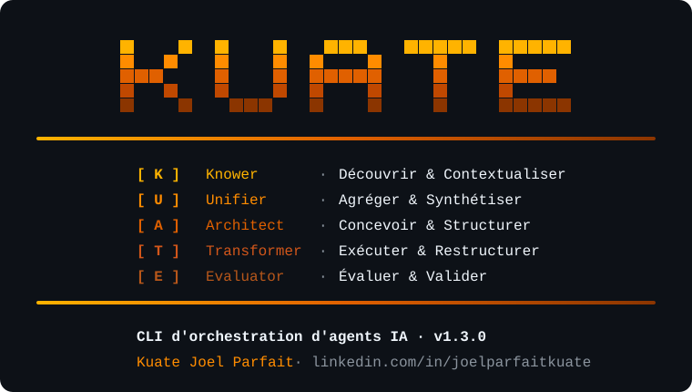

<p align="center">
  
</p>

# Methode KUATE

**CLI d'orchestration d'agents IA pour equipes structurees**

Auteur : KUATE JOEL PARFAIT — [LinkedIn](https://www.linkedin.com/in/joelparfaitkuate/)  
Licence : CC BY-NC-ND 4.0 — Usage personnel, partage autorise, modifications et usage commercial interdits  
Version : 1.3.0

**→ [Tutoriel complet — toutes les commandes](docs/TUTORIEL.md)**  
**→ [Scenario concret : LexiFlow SaaS de A a Z](docs/SCENARIO.md)**

---

## Presentation

Methode KUATE est un framework CLI open-source qui installe dans n'importe quel projet une methodologie structuree, des agents IA specialises et une memoire persistante. Il permet a Claude, ChatGPT, Gemini et Cursor de se comporter comme de veritables experts methodologiques.

Quatre differenciateurs principaux :

1. **Acronyme structurant** — 5 phases (K·U·A·T·E) forment la colonne vertebrale de toute la methode
2. **Moteur de methodologie** — les agents s'adaptent automatiquement a Agile, Lean, PMBOK, OKR, SAFe
3. **Memoire persistante** — contexte projet cumulatif reinjectable entre sessions IA
4. **Multilinguisme natif** — FR/EN, extensible par la communaute

---

## Les 5 phases KUATE

| Phase | Role | FR | EN |
|-------|------|----|-----|
| K | Knower | Découvrir & Contextualiser | Discover & Contextualize |
| U | Unifier | Agréger & Synthétiser | Aggregate & Synthesize |
| A | Architect | Concevoir & Structurer | Design & Structure |
| T | Transformer | Exécuter & Restructurer | Execute & Restructure |
| E | Evaluator | Évaluer & Valider | Evaluate & Validate |

---

## Installation

**Prerequis :** Node.js >= 20, npm >= 9

```bash
git clone https://github.com/kuatejoelparfait-Data/methode-kuate.git
cd methode-kuate
npm install
```

C'est tout. Le `npm install` compile automatiquement tous les packages et rend la commande `kuate` disponible globalement sur votre machine.

```bash
kuate --version   # 1.3.0
kuate init        # lancer le wizard
```

---

## Demarrage rapide

```bash
# 0. Laisser l'IA guider la session — suggère l'agent + la tâche selon l'état du projet
kuate next

# 1. Initialiser (wizard 6 étapes — description projet + selection IA des agents)
kuate init

# 2. Partagez KUATE.md avec Claude pour contextualiser votre projet
#    (généré automatiquement à l'init avec les agents, leurs rôles et phases)

# 3. Lancer une session guidée par phase
kuate phase K    # Knower     — analyse, user stories, contextualisation
kuate phase U    # Unifier    — backlog, planification sprint
kuate phase A    # Architect  — architecture, sécurité, schémas
kuate phase T    # Transformer — génération de code dans le projet
kuate phase E    # Evaluator  — tests, QA, documentation

# 4. Exécuter un agent directement sur une tâche précise
kuate run --agent dev-senior --task "créer le système d'authentification avec Clerk"

# 5. Session multi-experts sur une question
kuate conseil --agents "architecte-solution,expert-securite" --topic "..." --save

# 6. Remplir la mémoire du projet (wizard guidé)
kuate memory seed

# 7. Injecter le contexte dans une session IA externe
kuate memory inject

# 8. Exporter pour votre outil IA préféré
kuate build --target claude
```

---

## Commandes

### `kuate next` ⭐ Point d'entrée recommandé

L'assistant guidé. Analyse l'etat du projet et propose des actions concretes avec l'agent et la tache pre-remplis.

```bash
kuate next
```

```
  🧠 MonSaaS · Claude (Anthropic) / claude-haiku-4-5-20251001

  Quelle action lancer ?
  ❯ [K] business-analyst      Rédiger les user stories du module facturation
    [A] architecte-solution   Concevoir le schéma Prisma : users, invoices, clients
    [T] dev-senior            Créer le composant InvoiceCard avec shadcn/ui
    [A] expert-securite       Audit RGPD du formulaire de collecte données
    [U] chef-projet           Découper le MVP en 4 sprints de 2 semaines
    ✏  Décrire une autre tâche manuellement
    ✕  Quitter
```

Choisissez → l'agent s'execute, les fichiers sont sauvegardes, la memoire est mise a jour.
Apres chaque tache : nouvelles suggestions basees sur ce qui vient d'etre fait.

---

### `kuate cycle`

Analyse le cycle K·U·A·T·E et permet de l'ajuster. Sans appel IA par défaut.

```bash
kuate cycle              # vue des 5 phases + menu d'ajustements
kuate cycle --analyse    # + analyse de cohérence par IA (specs ↔ backlog ↔ archi ↔ code ↔ éval)
kuate cycle --json       # statut machine-lisible
```

Statuts : `produite`, `périmée` (une phase amont a été modifiée après), `validée`, `sautée`, `à faire`.
Ajustements : relancer une phase (ancien document sauvegardé dans `.kuate/backups/`), valider, sauter, rouvrir, ajouter une note transmise aux agents.
L'état est conservé dans `.kuate/cycle.json`. `kuate projet` ignore les phases sautées/validées et démarre à la première phase à faire ou périmée.

`kuate next` connaît le cycle : il affiche l'avancement, priorise les phases périmées, ne repropose pas ce qui est déjà fait, propose des suggestions de secours si l'IA est indisponible et sauvegarde les fichiers remplacés dans `.kuate/backups/`.

---

### `kuate spec`

Outil de **spécification en phases** (inspiré de BMAD et de GitHub Spec Kit). Objectif : sortir des phases K, U, A avec un paquet de specs **complet et vérifiable**, qu'un LLM de code (Claude Code, Copilot, Cursor) ou la phase T peut implémenter sans poser de question.

```bash
kuate spec                     # boucle pour la prochaine phase K/U/A incomplète
kuate spec constitution        # principes, stack, conventions (docs/constitution.md)
kuate spec clarify             # répond aux [NEEDS CLARIFICATION] ouverts
kuate spec analyze [--ai]      # porte de complétude -> docs/analysis.md (code de sortie 1 s'il reste des erreurs)
kuate spec stories             # un fichier de tâche autoportant par tâche (docs/stories/)
kuate spec export --target claude|copilot|cursor|agents   # passation
```

**Boucle d'une phase** : rédiger (agent principal) → relire (agents relecteurs) → réviser → clarifier (questions à l'humain) → porte.

| Phase | Agent principal | Relecteurs | Documents |
|---|---|---|---|
| K | `business-analyst` | `qa-strategist`, `expert-securite` | `docs/constitution.md`, `docs/specs.md` |
| U | `chef-projet` | `tech-lead` | `docs/backlog.md` |
| A | `architecte-solution` | `expert-securite`, `expert-devops`, `tech-lead` | `docs/architecture.md`, `docs/data-model.md`, `docs/contracts/*.md` |

**Formats analysables** (identifiants stables) :

```
### US-001 — Titre                                  (docs/specs.md)
- AC-001 (US-001) : Étant donné …, quand …, alors …

### T-001 [P] — Titre                               (docs/backlog.md)
Covers: US-001, AC-001
Depends: T-000
Files: src/auth/login.ts, src/auth/login.test.ts
Done when: critère vérifiable
```

`[NEEDS CLARIFICATION: question]` marque une ambiguïté dans n'importe quel document.

**Porte de complétude** (déterministe, sans IA) :

| Règle | Contrôle |
|---|---|
| G0 | `specs.md`, `backlog.md`, `architecture.md` présents et non vides |
| G1 | plus aucun `[NEEDS CLARIFICATION]`, `TBD`, `TODO`, « à définir », `???` (hors blocs de code) |
| G2 | au moins une story, chacune avec au moins un critère `AC-` |
| G3 / G4 | chaque story et chaque critère couverts par au moins une tâche |
| G5 | au moins une tâche ; chacune avec `Covers`, `Files`, `Done when` et des références existantes |
| G6 | dépendances existantes, sans cycle |
| G7 | sections d'architecture obligatoires ; `data-model.md` et `contracts/` si la constitution les déclare |
| G8 | aucun identifiant en double |

`kuate cycle` affiche l'état de porte de chaque phase. `kuate spec export` refuse de s'exécuter tant que la porte n'est pas passée (sauf `--force`) et sauvegarde tout fichier remplacé dans `.kuate/backups/`.

---

### `kuate init`

Lance le wizard interactif (6 etapes) pour initialiser la Methode KUATE dans le projet courant.

```
Etape 1 : Nom du projet
Etape 2 : Langue de travail (fr | en)
Etape 3 : Methodologie (agile | lean | pmbok | design-thinking | okr | safe | custom)
Etape 4 : Description du projet (texte libre)
Etape 5 : Configuration IA — provider + cle + modele (optionnel)
Etape 6 : Selection des agents
          - ✨ IA intelligente — analyse la description ou un fichier CDC
          - Manuel — selection par domaine
```

Genere dans le projet :
- `.kuate/config.yaml` — configuration du projet
- `.kuate/agents/*.md` — prompts des agents selectionnes
- `.kuate/context/*.md` — fichiers de memoire persistante (5 sections)
- `KUATE.md` — contexte maitre avec tous les agents, leurs roles et phases

---

### `KUATE.md` — Contexte maitre du projet

Genere automatiquement par `kuate init`. Contient :

- Description du projet
- Agents groupes par phase KUATE (K/U/A/T/E) avec leurs roles
- Workflow bash recommande
- Instructions pour Claude

**Usage :** Partagez `KUATE.md` en premier message dans Claude, ChatGPT ou Gemini. L'IA comprend immediatement la structure de votre projet et le role de chaque agent.

---

### `kuate agent`

```bash
kuate agent list              # Liste tous les agents installes
kuate agent use <nom>         # Copie le prompt dans le presse-papier
kuate agent info <nom>        # Fiche complete d'un agent
```

---

### `kuate workflow`

```bash
kuate workflow list                    # Liste les 27 workflows par phase
kuate workflow list --phase T          # Filtrer par phase (K|U|A|T|E)
kuate workflow show sprint-planning    # Fiche d'un workflow
```

---

### `kuate memory`

```bash
kuate memory show                          # Vue d'ensemble de la memoire
kuate memory show --section architecture   # Une section specifique
kuate memory add --section constraints     # Ajouter une entree
kuate memory seed                          # Wizard guidé pour remplir toutes les sections
kuate memory inject                        # Generer un bloc contexte pour session IA
```

Sections disponibles : `memory`, `architecture`, `business`, `constraints`, `glossary`

---

### `kuate build`

Exporte les agents pour differentes plateformes IA.

```bash
kuate build --target claude     # Genere CLAUDE.md
kuate build --target chatgpt    # Genere chatgpt-instructions.json
kuate build --target gemini     # Genere gemini-gem.md
kuate build --target cursor     # Genere .cursorrules
kuate build --target copilot    # Genere .github/copilot-instructions.md
kuate build --target pack       # Genere un pack partageable
```

---

### `kuate conseil`

Mode multi-agents : plusieurs experts IA en simultane sur un sujet.

```bash
kuate conseil \
  --agents "architecte-solution,expert-securite,tech-lead" \
  --topic "Quelle architecture pour une app Next.js avec 100k utilisateurs ?" \
  --save
```

Genere un prompt structurant plusieurs experts autour du sujet, pret a etre colle dans Claude ou ChatGPT.

---

### `kuate phase <K|U|A|T|E>`

Session guidée et interactive pour une phase KUATE. L'agent IA génère du code, des specs ou des analyses **directement dans votre projet** via l'API configurée.

```bash
kuate phase K   # Knower    — analyse, user stories, risques
kuate phase U   # Unifier   — backlog, sprints, planification
kuate phase A   # Architect — architecture, sécurité, schémas
kuate phase T   # Transformer — génération de code dans le projet
kuate phase E   # Evaluator  — tests, QA, documentation
```

Boucle interactive : choisir l'agent → décrire la tâche → réponse IA streamée → sauvegarder fichiers générés → note mémoire → continuer ou passer à la phase suivante.

---

### `kuate run`

Exécute un agent IA sur une tâche précise. Le code généré est détecté automatiquement et proposé à la sauvegarde dans le projet.

```bash
kuate run --agent dev-senior --task "créer le système d'authentification avec Clerk"
kuate run --agent architecte-solution --task "concevoir le schéma Prisma pour LexiFlow"
kuate run --agent expert-securite --task "audit OWASP du module de signature"
```

---

### `kuate conseil`

Mode multi-agents : plusieurs experts IA en simultanee sur un sujet, avec option de sauvegarde en memoire.

```bash
kuate conseil \
  --agents "architecte-solution,expert-securite,tech-lead" \
  --topic "Quelle architecture pour une app Next.js avec 100k utilisateurs ?" \
  --save
```

---

### `kuate config ai`

Configure le provider IA (Claude ou OpenAI) pour la generation automatique du contexte projet.

```bash
kuate config ai
# → choisir Claude / OpenAI, entrer la cle, choisir le modele
# Cle stockee dans ~/.kuate/global.json (non versionnee)
```

---

### `kuate doctor`

Diagnostic complet de l'installation.

```bash
kuate doctor
```

Verifie : version Node.js, npm, presence `.kuate/`, validite config, agents generes, contexte.

---

### `kuate config show`

Affiche la configuration courante du projet.

---

## Les 23 agents

### Dev Software (8 agents)

| ID | Phase | Description |
|----|-------|-------------|
| `architecte-solution` | A | Conception systemes, TOGAF-aware |
| `dev-senior` | T | Implementation TDD, clean code |
| `expert-devops` | T | CI/CD, Docker, Kubernetes |
| `expert-securite` | A | OWASP, threat modeling, audit |
| `qa-strategist` | E | Tests bases sur le risque |
| `tech-lead` | T | Revue de code, mentoring |
| `expert-performance` | E | Optimisation, Core Web Vitals |
| `expert-ia-ml` | T | Integration modeles IA, MLOps |

### Business et Strategie (6 agents)

| ID | Phase | Description |
|----|-------|-------------|
| `chef-projet` | U | PMBOK, jalons, risques |
| `coach-agile` | U | Scrum, Kanban, SAFe |
| `business-analyst` | K | Exigences, BDD, user stories |
| `expert-lean` | U | VSM, reduction gaspillages |
| `stratege-okr` | U | OKR, alignement, suivi |
| `expert-finance-tech` | K | Budget, ROI, business case |

### Creation de Contenu (5 agents)

| ID | Phase | Description |
|----|-------|-------------|
| `copywriter-technique` | E | Docs techniques, README, API |
| `expert-seo` | E | SEO, mots-cles, Core Web Vitals |
| `social-media-strategist` | T | Calendrier editorial, engagement |
| `expert-communication` | K | Relations presse, stakeholders |
| `createur-formation` | A | Curriculum, ADDIE |

### Formation et Pedagogie (4 agents)

| ID | Phase | Description |
|----|-------|-------------|
| `concepteur-pedagogique` | A | ADDIE, taxonomie de Bloom |
| `tuteur-ia` | T | Apprentissage personnalise |
| `evaluateur-competences` | E | Assessment, certifications |
| `createur-contenu-educatif` | T | Videos, cours, exercices |

---

## Les 7 methodologies supportees

| Methodologie | Workflows actives |
|---|---|
| `agile` | Sprint Planning, Backlog Grooming, Retrospective, Review |
| `lean` | Value Stream Mapping, Kaizen, 5S Digital |
| `pmbok` | Charte Projet, WBS, RACI, Rapport Avancement |
| `design-thinking` | Empathize, Define, Ideate, Prototype, Test |
| `okr` | OKR Definition, Weekly Check-in, Quarterly Review |
| `safe` | PI Planning, ART Sync, Solution Demo |
| `custom` | Definis par l'utilisateur |

---

## Structure generee dans le projet

```
.kuate/
|-- config.yaml           Methodologie, langue, agents actifs
|-- agents/               Un fichier .md par agent (prompt pret a l'emploi)
|   |-- architecte-solution.md
|   |-- dev-senior.md
|   `-- ...
`-- context/
    |-- memory.md         Log chronologique des decisions
    |-- architecture.md   Choix techniques et rationale
    |-- business.md       Contexte metier et stakeholders
    |-- constraints.md    Contraintes non-negociables
    `-- glossary.md       Termes specifiques au projet
```

---

## Architecture du monorepo

```
methode-kuate/
|-- packages/
|   |-- cli/              CLI principale (bin: kuate + methode-kuate)
|   |-- core/             Moteur de methodologie, sans UI
|   |-- agents-dev/       8 agents Dev Software
|   |-- agents-business/  6 agents Business et Strategie
|   |-- agents-content/   5 agents Creation de Contenu
|   `-- agents-education/ 4 agents Formation et Pedagogie
|-- templates/
|   `-- methodology/      agile.yaml, lean.yaml, pmbok.yaml, etc.
`-- docs/                 Specifications et plans
```

---

## Stack technique

- **Runtime** : Node.js 20+, TypeScript 5, ESM
- **CLI** : Commander.js, @clack/prompts, chalk, ora
- **Moteur** : Handlebars (templates), Zod (validation), yaml, fs-extra
- **Build** : tsup, npm workspaces
- **Tests** : vitest v2

---

## Licence

Creative Commons Attribution-NonCommercial-NoDerivatives 4.0 International (CC BY-NC-ND 4.0)

Copyright (c) 2026 KUATE JOEL PARFAIT  
[linkedin.com/in/joelparfaitkuate](https://www.linkedin.com/in/joelparfaitkuate/)

Voir le fichier [LICENSE](./LICENSE) pour les termes complets.
